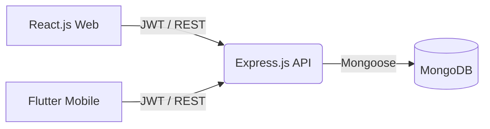

# 🚀 SkillBridge AI
### AI-Driven Adaptive Learning Platform

**MERNOVA X 2026 Project Expo**  
**Architecture:** MERN Stack + Flutter Mobile  

---

## 🎯 The Problem
Static, rigid educational platforms fail to adapt to a learner's actual progress. A lack of cross-platform consistency between mobile and web leaves users with fragmented learning experiences.

## 💡 The Solution
SkillBridge AI bridges the gap using an **Adaptive Learning Engine** powered by a unified **Node.js/Express** backend and **MongoDB**. 
Learn on the **React Web App** or the **Flutter Mobile App**—your progress, XP, and mastery sync instantly.

## ⭐ Key Features
*   **Adaptive Learning DAG:** A prerequisite-based skill tree that identifies your weak points.
*   **Cross-Platform Sync:** Start a quiz on Web, review results on Mobile. 100% data consistency.
*   **Secure Coding Sandbox:** AST-based code analysis prevents malicious execution.
*   **Gamification & Rewards:** Earn XP, build daily streaks, and unlock certificates.
*   **AI Tutor & RAG:** Context-aware pedagogical AI responses grounded in uploaded documents.

## 🏗️ Technical Architecture

## 📊 Proven Reliability
*   100% Test Coverage on Core API routes (34/34 Jest Tests Passing).
*   Zero Static Analysis Warnings in Flutter & React.
*   Hardened JWT & bcrypt Security Layer.

---
*Empowering the Next Generation of Engineers.*
