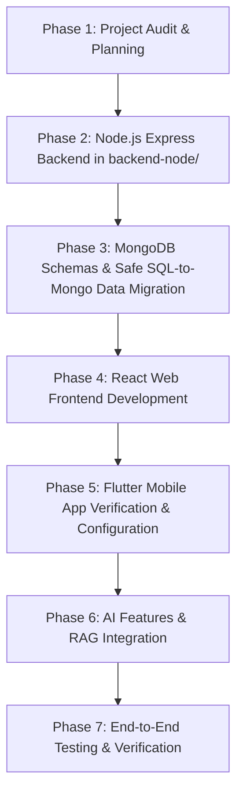

# SkillBridge AI: Comprehensive MERN + Flutter Migration Plan

## 1. Executive Summary & Objective

This document defines the architectural transformation and incremental migration of **SkillBridge AI** from its existing Python FastAPI + SQLAlchemy + MySQL/SQLite stack into an enterprise-grade **MERN + Flutter** full-stack ecosystem:
- **Backend**: Node.js (v24 LTS) + Express + Mongoose + TypeScript/ES Modules
- **Database**: MongoDB (v6.0+) with schema parity, relational emulation, and automated data migration
- **Web Frontend**: React 18+ (Vite) single-page application with responsive design, glassmorphism UI, dual Student & Admin portals
- **Mobile Client**: Flutter 3.47+ Android & Web mobile client with unified API client integration
- **AI & Adaptive Engines**: Fully preserved provider-independent AI Tutor, RAG pipeline, AST code evaluator, and adaptive learning graph
- **Zero Loss Guarantee**: 100% preservation of all existing business logic, validation rules, security guarantees, data records, and test coverage.

---

## 2. Existing System Architecture vs. Target MERN Architecture

| Layer | Existing Architecture | Target Architecture | Parity Strategy |
| :--- | :--- | :--- | :--- |
| **Backend Runtime** | Python 3.10+, FastAPI (ASGI), Uvicorn | Node.js v24+, Express.js | Full endpoint-by-endpoint route parity under `/api/v1` |
| **Database & ORM** | MySQL 8.0+ / SQLite, SQLAlchemy 2.0, Alembic | MongoDB 6.0+, Mongoose 8.x ODM | Schema mapping with indexed relational foreign keys (`ObjectId` + `legacyId`) |
| **Authentication** | Bcrypt (12 rounds) + PyJWT (`HS256`) | Bcrypt.js (12 rounds) + jsonwebtoken (`HS256`) | Identical token claims (`sub`, `role`, `type`, `exp`, `iat`) and password hash verification |
| **Role-Based Access** | FastAPI `Depends(get_current_admin)` | Express middleware `authenticate`, `requireRole` | Server-side role enforcement on all protected routes |
| **Web & Admin Frontends** | Flutter Web Admin Dashboard | React 18 SPA (Vite) + Preserved Flutter Web Admin (`admin_dashboard/`) | Unifies learner portal & admin tools across React Web and Flutter Web Admin connected to Node.js API |
| **Mobile App** | Flutter 3.47 Android client (`mobile_app/`) | Flutter 3.47 Android/iOS/Web client | Upgraded API client with dynamic base URL and multi-platform compatibility |
| **Adaptive Learning** | Bayesian EMA update engine (`adaptive_engine.py`) | JavaScript Adaptive Engine (`adaptiveEngine.js`) | Exact mathematical parity for score updates, confidence calibration, and weak-concept detection |
| **AI Tutor Adapter** | Multi-provider LLM adapter (Gemini/OpenAI/Fallback) | Node.js AI Tutor orchestrator (`aiAdapter.js`) | Exact prompt engineering, token metrics, rate limits, and deterministic offline fallback |
| **RAG Pipeline** | PyPDF + TF-IDF Vector Index + sliding window chunking | Text extraction + TF-IDF Vector Index + chunking service | Substring/vector scoring, citation generation, prompt injection defense |
| **Coding Sandbox** | Safe AST syntax & security analysis | Static pattern/delimiter AST analyzer (`codingService.js`) + isolated Node child subprocess when enabled | Static enforcement of blocked modules/prototypes + `spawnSync` child process boundary (`--disallow-code-generation-from-strings`, `--no-addons`, stripped env) |

---

## 3. Incremental Migration Phases



### Phase 1: Complete Project Audit (Completed)
- Audited all 20+ SQL models, Alembic migrations, and DDL schema.
- Audited 15 API routers across 50+ endpoints under `/api/v1`.
- Audited Flutter mobile app (`mobile_app`) and Flutter web admin (`admin_dashboard`).
- Documented feature parity requirements and endpoint-by-endpoint mapping.

### Phase 2: Node.js + Express Backend (`backend-node/`)
- Establish directory structure:
  ```text
  backend-node/
  ├── package.json
  ├── .env.example
  ├── src/
  │   ├── server.js               # Server startup & port binding
  │   ├── app.js                  # Express app setup, CORS, JSON, security headers
  │   ├── config/                 # Env variables, database connection, JWT constants
  │   ├── middleware/             # Auth, role check, error handler, rate limiter, logger
  │   ├── models/                 # 20+ Mongoose models matching SQL tables
  │   ├── routes/                 # Express routers mounted on /api/v1/*
  │   ├── controllers/            # Controller logic translating requests to responses
  │   ├── services/               # Core business logic (Adaptive, RAG, Tutor, Career, Coding)
  │   └── ai/                     # AI adapter, deterministic fallback, prompt defenses
  ├── scripts/
  │   ├── migrate_sql_to_mongo.js # Repeatable SQL-to-MongoDB migration tool
  │   └── seed_mongo.js           # Seed MongoDB with taxonomy, careers, questions
  └── tests/                      # Jest / Supertest API test suite
  ```
- Implement centralized error handling with uniform JSON responses: `{ "detail": "..." }` to maintain exact client compatibility.
- Implement JWT access and refresh token lifecycle matching FastAPI contracts.

### Phase 3: Safe Data Migration to MongoDB
- Retain existing SQLite (`skillbridge_dev.db`) and MySQL databases without mutation.
- Design Mongoose schemas preserving numeric foreign keys via `legacyId` or direct references.
- Implement migration CLI with flags: `--dry-run`, `--verify`, `--batch-size`.
- Verify hash integrity: Passwords hashed via Bcrypt in Python verify identically in Node.js bcrypt.

### Phase 4: Upgrade & Implement React Web Frontend (`frontend/`)
- Initialize high-performance React (Vite) application.
- Build clean, modern CSS design system with CSS custom properties (color palettes, shadows, glassmorphism, responsive grids).
- Implement routes matching all platform capabilities:
  - `/` Landing / Welcome Page
  - `/login`, `/register`, `/forgot-password` Authentication
  - `/dashboard` Student Overview & Adaptive Next Steps
  - `/taxonomy` Interactive 9-domain Skill Prerequisite DAG
  - `/assessments` & `/assessments/:id` Quiz taker with timer & diagnostic explanations
  - `/careers` & `/careers/:slug` Career Gap Analysis & 30/60/90-Day Roadmap Generator
  - `/projects` & `/projects/:id` Milestone portfolio & rubric submissions
  - `/tutor` AI Tutor Pedagogical Chat & Document grounding
  - `/coding` Algorithmic Coding Practice with AST analysis feedback
  - `/feedback` Learner feedback & issue submission
  - `/admin` Comprehensive Management Console: Users, Skills, Assessments, Careers, Projects, Document Approvals, Feedback Review, Analytics, Audit Logs, and CSV Exports.

### Phase 5: Upgrade Flutter Mobile & Admin Clients (`mobile_app/` & `admin_dashboard/`)
- Retain existing Flutter mobile app architecture in `mobile_app/` and Flutter Web Admin Console in `admin_dashboard/`.
- Configure `AppConfig.effectiveBaseUrl` for Web (`localhost`), Android emulator (`10.0.2.2`), and physical Android LAN override, plus `debug/AndroidManifest.xml` cleartext isolation.
- Run Flutter analysis (`flutter analyze`), widget/unit tests (`flutter test`), Android APK build (`flutter build apk --debug`), and Admin Web build (`flutter build web`).

### Phase 6: AI Features Preservation
- Multi-provider LLM adapter supporting Gemini, OpenAI, Mock, and Deterministic Fallback.
- Complete domain concept database in fallback mode (Python, SQL, DSA, Networking, Cybersecurity, Java, React).
- Grounded RAG with sliding-window chunking, TF-IDF vector retrieval, and prompt injection defense.

### Phase 7: Verification & Quality Assurance
- Automated backend tests (authentication, role access, assessment scoring, career gap analysis, tutor query).
- Automated React build (`npm run build`).
- Automated Flutter test suite execution.
- End-to-end integration verification.
