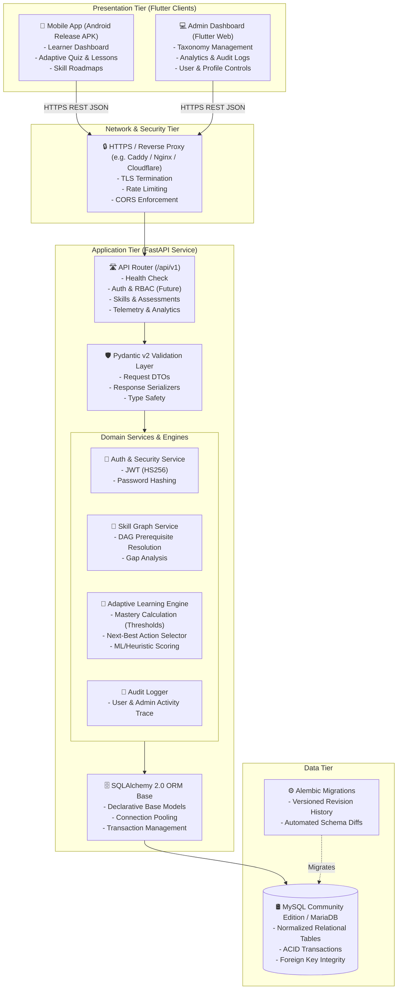
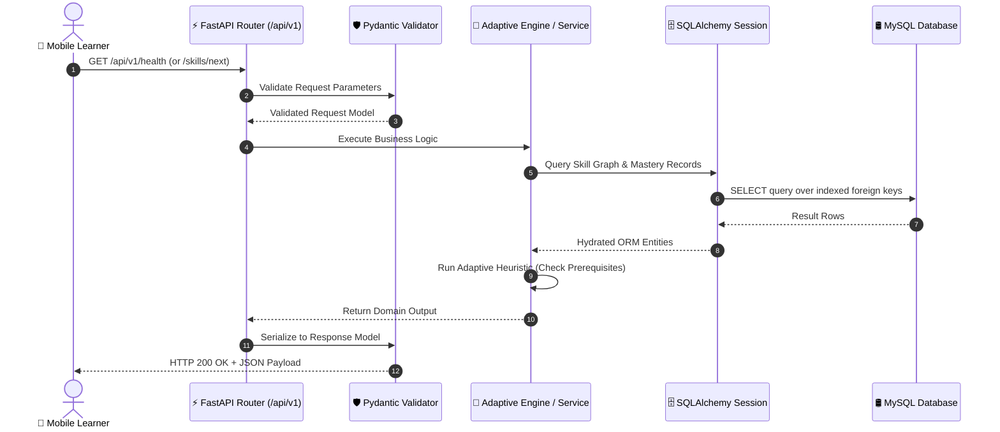

# SkillBridge AI - System Architecture Document 🏗️

## 1. Executive Summary

SkillBridge AI is an adaptive, knowledge-graph-driven educational platform designed to guide learners from novice competency to professional mastery. The system is architected as a decoupled, multi-tier system:
1. **Presentation Layer**: 
   - **Mobile App**: Cross-platform Flutter client optimized for Android (distributed as a standalone release APK).
   - **Admin Dashboard**: Flutter Web application tailored for instructors, curriculum designers, and administrators.
2. **API & Business Logic Layer**:
   - Asynchronous **FastAPI** application running on Python 3.10+, enforcing strict schema contracts with **Pydantic v2**.
   - **Adaptive AI Engine**: Hybrid decision system incorporating prerequisite graph traversal, Bayesian/item-response inspired mastery heuristics, and activity telemetry.
3. **Persistence & Data Layer**:
   - **MySQL 8/9 Community Edition** (relational persistence) accessed asynchronously or synchronously via **SQLAlchemy 2.0** ORM.
   - Version-controlled schema migrations powered by **Alembic**.

---

## 2. High-Level Architecture Diagram

---

## 3. Request Lifecycle & Data Flow

---

## 4. Architectural Principles & Separation of Concerns

### A. Frontend (Flutter Mobile & Web)
1. **Clean Feature Separation**: Code is partitioned into `core/` (cross-cutting themes, networking, configurations, routing), `features/` (encapsulated domains like onboarding, learning, assessments), and `shared/` (reusable UI widgets and helpers).
2. **No Business Logic in Widgets**: Flutter widgets are purely presentational. They receive state and emit user events. State and API orchestration are handled in dedicated controllers or service clients.
3. **Environment-Agnostic API Clients**: The base URL and environment configurations are injected via compile-time variables or static runtime configs (`AppConfig`), enabling seamless transitions from `http://10.0.2.2:8000` (Android emulator) to `https://api.yourdomain.com` in production.

### B. Backend (FastAPI & SQLAlchemy)
1. **Strict Dependency Injection**: FastAPI's `Depends` system provides database sessions (`get_db`) and settings (`get_settings`) on a per-request basis with guaranteed cleanup and rollback on exception.
2. **Stateless Service Architecture**: The API remains stateless. Authentication is managed via JWT tokens, ensuring that backend workers can be horizontally scaled behind a load balancer without sticky sessions.
3. **Zero Secrets in Code**: All configuration is loaded from environment variables using `pydantic-settings` with default fallbacks for local dev and strict validation for production.
4. **Relational Normalization First**: The schema design strictly separates mutable telemetry (`learner_activity`, `responses`) from relational taxonomies (`skills`, `prerequisites`, `careers`).

---

## 5. Security Architecture

1. **Transport Layer**: All remote communications between the Android APK and the backend require HTTPS (TLS 1.2+).
2. **CORS Security**: Cross-Origin Resource Sharing is locked down to known dashboard and mobile domains, preventing cross-site scripting attacks from unauthorized origins.
3. **Credential Storage**: Passwords and secrets are hashed using industry-standard adaptive hashing algorithms (Argon2 / Bcrypt). No plaintext credentials exist in databases or logs.
4. **Audit Logging**: Sensitive administrative actions and state modifications are tracked in a dedicated `admin_audit_logs` table.
