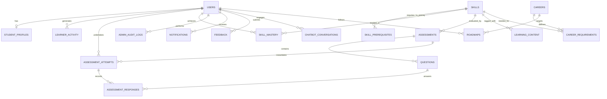

# SkillBridge AI - Relational Database Schema Design 🗄️

## 1. Schema Overview & Normalization Goals

The SkillBridge AI data store is designed to Third Normal Form (3NF) to guarantee data integrity, eliminate redundancy, and support high-throughput telemetry from mobile learners. The complete domain architecture encompasses **20 normalized tables**, organized into six functional subsystems:

1. **Identity & Access Management (IAM)**: `users`, `student_profiles`
2. **Skill Taxonomy & Dependency Graphs**: `skills`, `skill_prerequisites`, `skill_mastery`
3. **Assessment & Diagnostic Evaluation Engine**: `assessments`, `questions`, `assessment_attempts`, `assessment_responses`
4. **Curriculum, Roadmaps & Career Pathways**: `learning_content`, `careers`, `career_requirements`, `roadmaps`, `projects`
5. **Adaptive Telemetry & Collaboration**: `learner_activity`, `documents`, `chatbot_conversations`, `feedback`, `notifications`
6. **Governance & Compliance**: `admin_audit_logs`

---

## 2. Entity-Relationship Overview

---

## 3. Normalized Table Specifications

### Subsystem 1: Identity & Access Management
1. **`users`**
   - `id`: BIGINT UNSIGNED AUTO_INCREMENT PRIMARY KEY
   - `email`: VARCHAR(255) UNIQUE NOT NULL (Index)
   - `hashed_password`: VARCHAR(255) NOT NULL
   - `full_name`: VARCHAR(150) NOT NULL
   - `role`: ENUM('student', 'instructor', 'admin', 'superadmin') DEFAULT 'student'
   - `is_active`: BOOLEAN DEFAULT TRUE
   - `is_verified`: BOOLEAN DEFAULT FALSE
   - `created_at`: TIMESTAMP DEFAULT CURRENT_TIMESTAMP
   - `updated_at`: TIMESTAMP DEFAULT CURRENT_TIMESTAMP ON UPDATE CURRENT_TIMESTAMP

2. **`student_profiles`**
   - `id`: BIGINT UNSIGNED AUTO_INCREMENT PRIMARY KEY
   - `user_id`: BIGINT UNSIGNED UNIQUE NOT NULL (FK -> `users.id` ON DELETE CASCADE)
   - `headline`: VARCHAR(200) NULL
   - `bio`: TEXT NULL
   - `target_role`: VARCHAR(150) NULL
   - `education_level`: VARCHAR(100) NULL
   - `target_hours_per_week`: INT UNSIGNED DEFAULT 10
   - `preferred_learning_style`: VARCHAR(50) DEFAULT 'visual'
   - `created_at`: TIMESTAMP DEFAULT CURRENT_TIMESTAMP
   - `updated_at`: TIMESTAMP DEFAULT CURRENT_TIMESTAMP ON UPDATE CURRENT_TIMESTAMP

---

### Subsystem 2: Skill Taxonomy & Graph
3. **`skills`**
   - `id`: BIGINT UNSIGNED AUTO_INCREMENT PRIMARY KEY
   - `slug`: VARCHAR(100) UNIQUE NOT NULL (Index)
   - `title`: VARCHAR(150) NOT NULL
   - `category`: VARCHAR(100) NOT NULL (Index)
   - `description`: TEXT NULL
   - `difficulty_level`: ENUM('beginner', 'intermediate', 'advanced', 'expert') DEFAULT 'beginner'
   - `created_at`: TIMESTAMP DEFAULT CURRENT_TIMESTAMP
   - `updated_at`: TIMESTAMP DEFAULT CURRENT_TIMESTAMP ON UPDATE CURRENT_TIMESTAMP

4. **`skill_prerequisites`** (Self-referential DAG edges)
   - `id`: BIGINT UNSIGNED AUTO_INCREMENT PRIMARY KEY
   - `skill_id`: BIGINT UNSIGNED NOT NULL (FK -> `skills.id` ON DELETE CASCADE)
   - `prerequisite_skill_id`: BIGINT UNSIGNED NOT NULL (FK -> `skills.id` ON DELETE RESTRICT)
   - `requirement_type`: ENUM('mandatory', 'recommended') DEFAULT 'mandatory'
   - `created_at`: TIMESTAMP DEFAULT CURRENT_TIMESTAMP
   - UNIQUE KEY (`skill_id`, `prerequisite_skill_id`)

5. **`skill_mastery`**
   - `id`: BIGINT UNSIGNED AUTO_INCREMENT PRIMARY KEY
   - `user_id`: BIGINT UNSIGNED NOT NULL (FK -> `users.id` ON DELETE CASCADE)
   - `skill_id`: BIGINT UNSIGNED NOT NULL (FK -> `skills.id` ON DELETE CASCADE)
   - `mastery_score`: DECIMAL(5, 4) NOT NULL DEFAULT 0.0000 (0.0000 to 1.0000)
   - `confidence_score`: DECIMAL(5, 4) NOT NULL DEFAULT 0.5000
   - `status`: ENUM('locked', 'unlocked', 'in_progress', 'mastered') DEFAULT 'unlocked'
   - `last_practiced_at`: TIMESTAMP NULL
   - `created_at`: TIMESTAMP DEFAULT CURRENT_TIMESTAMP
   - `updated_at`: TIMESTAMP DEFAULT CURRENT_TIMESTAMP ON UPDATE CURRENT_TIMESTAMP
   - UNIQUE KEY (`user_id`, `skill_id`)

---

### Subsystem 3: Assessments & Diagnostics
6. **`assessments`**
   - `id`: BIGINT UNSIGNED AUTO_INCREMENT PRIMARY KEY
   - `title`: VARCHAR(200) NOT NULL
   - `description`: TEXT NULL
   - `skill_id`: BIGINT UNSIGNED NOT NULL (FK -> `skills.id` ON DELETE CASCADE)
   - `assessment_type`: ENUM('diagnostic', 'formative', 'summative') DEFAULT 'formative'
   - `pass_percentage`: DECIMAL(5, 2) DEFAULT 75.00
   - `time_limit_minutes`: INT UNSIGNED NULL
   - `created_at`: TIMESTAMP DEFAULT CURRENT_TIMESTAMP

7. **`questions`**
   - `id`: BIGINT UNSIGNED AUTO_INCREMENT PRIMARY KEY
   - `assessment_id`: BIGINT UNSIGNED NOT NULL (FK -> `assessments.id` ON DELETE CASCADE)
   - `prompt`: TEXT NOT NULL
   - `question_type`: ENUM('single_choice', 'multiple_choice', 'code_snippet', 'short_answer') DEFAULT 'single_choice'
   - `options_json`: JSON NOT NULL
   - `correct_answer_json`: JSON NOT NULL
   - `explanation`: TEXT NULL
   - `difficulty`: ENUM('easy', 'medium', 'hard') DEFAULT 'medium'
   - `points`: INT UNSIGNED DEFAULT 10
   - `created_at`: TIMESTAMP DEFAULT CURRENT_TIMESTAMP

8. **`assessment_attempts`**
   - `id`: BIGINT UNSIGNED AUTO_INCREMENT PRIMARY KEY
   - `assessment_id`: BIGINT UNSIGNED NOT NULL (FK -> `assessments.id` ON DELETE CASCADE)
   - `user_id`: BIGINT UNSIGNED NOT NULL (FK -> `users.id` ON DELETE CASCADE)
   - `score_achieved`: DECIMAL(5, 2) DEFAULT 0.00
   - `is_passed`: BOOLEAN DEFAULT FALSE
   - `started_at`: TIMESTAMP DEFAULT CURRENT_TIMESTAMP
   - `completed_at`: TIMESTAMP NULL

9. **`assessment_responses`**
   - `id`: BIGINT UNSIGNED AUTO_INCREMENT PRIMARY KEY
   - `attempt_id`: BIGINT UNSIGNED NOT NULL (FK -> `assessment_attempts.id` ON DELETE CASCADE)
   - `question_id`: BIGINT UNSIGNED NOT NULL (FK -> `questions.id` ON DELETE CASCADE)
   - `learner_response_json`: JSON NOT NULL
   - `is_correct`: BOOLEAN NOT NULL
   - `time_spent_seconds`: INT UNSIGNED DEFAULT 0
   - `diagnostic_feedback`: TEXT NULL
   - `created_at`: TIMESTAMP DEFAULT CURRENT_TIMESTAMP

---

### Subsystem 4: Content, Careers & Pathways
10. **`learning_content`**
    - `id`: BIGINT UNSIGNED AUTO_INCREMENT PRIMARY KEY
    - `skill_id`: BIGINT UNSIGNED NOT NULL (FK -> `skills.id` ON DELETE CASCADE)
    - `title`: VARCHAR(200) NOT NULL
    - `content_type`: ENUM('video', 'article', 'interactive_exercise', 'documentation') NOT NULL
    - `body_markdown`: LONGTEXT NULL
    - `external_url`: VARCHAR(500) NULL
    - `estimated_duration_minutes`: INT UNSIGNED DEFAULT 15
    - `created_at`: TIMESTAMP DEFAULT CURRENT_TIMESTAMP

11. **`careers`**
    - `id`: BIGINT UNSIGNED AUTO_INCREMENT PRIMARY KEY
    - `slug`: VARCHAR(100) UNIQUE NOT NULL
    - `title`: VARCHAR(150) NOT NULL
    - `description`: TEXT NULL
    - `average_salary_range`: VARCHAR(100) NULL
    - `industry`: VARCHAR(100) NULL
    - `created_at`: TIMESTAMP DEFAULT CURRENT_TIMESTAMP

12. **`career_requirements`**
    - `id`: BIGINT UNSIGNED AUTO_INCREMENT PRIMARY KEY
    - `career_id`: BIGINT UNSIGNED NOT NULL (FK -> `careers.id` ON DELETE CASCADE)
    - `skill_id`: BIGINT UNSIGNED NOT NULL (FK -> `skills.id` ON DELETE CASCADE)
    - `minimum_mastery_level`: DECIMAL(5, 4) DEFAULT 0.8000
    - `weight`: DECIMAL(3, 2) DEFAULT 1.00
    - UNIQUE KEY (`career_id`, `skill_id`)

13. **`roadmaps`**
    - `id`: BIGINT UNSIGNED AUTO_INCREMENT PRIMARY KEY
    - `user_id`: BIGINT UNSIGNED NOT NULL (FK -> `users.id` ON DELETE CASCADE)
    - `career_id`: BIGINT UNSIGNED NULL (FK -> `careers.id` ON DELETE SET NULL)
    - `title`: VARCHAR(200) NOT NULL
    - `milestones_json`: JSON NOT NULL
    - `completion_percentage`: DECIMAL(5, 2) DEFAULT 0.00
    - `created_at`: TIMESTAMP DEFAULT CURRENT_TIMESTAMP

14. **`projects`**
    - `id`: BIGINT UNSIGNED AUTO_INCREMENT PRIMARY KEY
    - `title`: VARCHAR(200) NOT NULL
    - `description`: TEXT NOT NULL
    - `difficulty`: ENUM('beginner', 'intermediate', 'advanced') DEFAULT 'beginner'
    - `rubric_json`: JSON NOT NULL
    - `created_at`: TIMESTAMP DEFAULT CURRENT_TIMESTAMP

---

### Subsystem 5: Telemetry, AI Chat & Collaboration
15. **`learner_activity`**
    - `id`: BIGINT UNSIGNED AUTO_INCREMENT PRIMARY KEY
    - `user_id`: BIGINT UNSIGNED NOT NULL (FK -> `users.id` ON DELETE CASCADE)
    - `activity_type`: VARCHAR(50) NOT NULL (e.g. `quiz_completed`, `lesson_viewed`, `daily_streak`)
    - `metadata_json`: JSON NULL
    - `created_at`: TIMESTAMP DEFAULT CURRENT_TIMESTAMP (Index)

16. **`documents`**
    - `id`: BIGINT UNSIGNED AUTO_INCREMENT PRIMARY KEY
    - `title`: VARCHAR(255) NOT NULL
    - `file_path`: VARCHAR(500) NOT NULL
    - `file_type`: VARCHAR(50) NOT NULL
    - `file_size_bytes`: BIGINT UNSIGNED NOT NULL
    - `uploaded_by`: BIGINT UNSIGNED NOT NULL (FK -> `users.id`)
    - `created_at`: TIMESTAMP DEFAULT CURRENT_TIMESTAMP

17. **`chatbot_conversations`**
    - `id`: BIGINT UNSIGNED AUTO_INCREMENT PRIMARY KEY
    - `user_id`: BIGINT UNSIGNED NOT NULL (FK -> `users.id` ON DELETE CASCADE)
    - `session_id`: VARCHAR(100) NOT NULL (Index)
    - `sender`: ENUM('user', 'assistant', 'system') NOT NULL
    - `message`: TEXT NOT NULL
    - `referenced_skill_id`: BIGINT UNSIGNED NULL (FK -> `skills.id` ON DELETE SET NULL)
    - `created_at`: TIMESTAMP DEFAULT CURRENT_TIMESTAMP

18. **`feedback`**
    - `id`: BIGINT UNSIGNED AUTO_INCREMENT PRIMARY KEY
    - `user_id`: BIGINT UNSIGNED NOT NULL (FK -> `users.id` ON DELETE CASCADE)
    - `feedback_type`: ENUM('general', 'content_issue', 'bug', 'feature_request') NOT NULL
    - `rating`: INT UNSIGNED NULL
    - `comment`: TEXT NOT NULL
    - `created_at`: TIMESTAMP DEFAULT CURRENT_TIMESTAMP

19. **`notifications`**
    - `id`: BIGINT UNSIGNED AUTO_INCREMENT PRIMARY KEY
    - `user_id`: BIGINT UNSIGNED NOT NULL (FK -> `users.id` ON DELETE CASCADE)
    - `title`: VARCHAR(200) NOT NULL
    - `body`: TEXT NOT NULL
    - `is_read`: BOOLEAN DEFAULT FALSE
    - `action_url`: VARCHAR(255) NULL
    - `created_at`: TIMESTAMP DEFAULT CURRENT_TIMESTAMP

---

### Subsystem 6: Governance & Audit
20. **`admin_audit_logs`**
    - `id`: BIGINT UNSIGNED AUTO_INCREMENT PRIMARY KEY
    - `admin_id`: BIGINT UNSIGNED NOT NULL (FK -> `users.id`)
    - `action`: VARCHAR(100) NOT NULL
    - `entity_type`: VARCHAR(100) NOT NULL
    - `entity_id`: VARCHAR(100) NULL
    - `details_json`: JSON NULL
    - `ip_address`: VARCHAR(45) NULL
    - `created_at`: TIMESTAMP DEFAULT CURRENT_TIMESTAMP

---

## 4. Part 1 Foundational Schema Scope

Per Part 1 requirements, the complete normalized 20-table architecture is fully designed and documented above. In code, the foundation models are implemented in SQLAlchemy with Alembic migrations:
- Core IAM: `users`, `student_profiles`
- Core Graph: `skills`, `skill_prerequisites`, `skill_mastery`
- Telemetry: `learner_activity`
- Governance: `admin_audit_logs`

Subsequent tables (`assessments`, `questions`, `roadmaps`, `careers`, etc.) will be progressively activated in Parts 2 through 4 as their business services are built.
